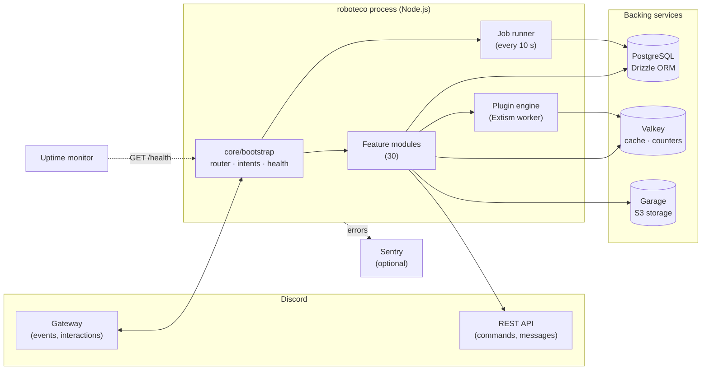
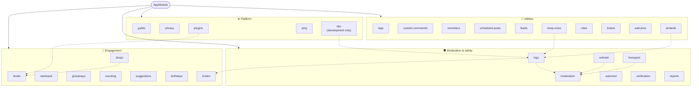
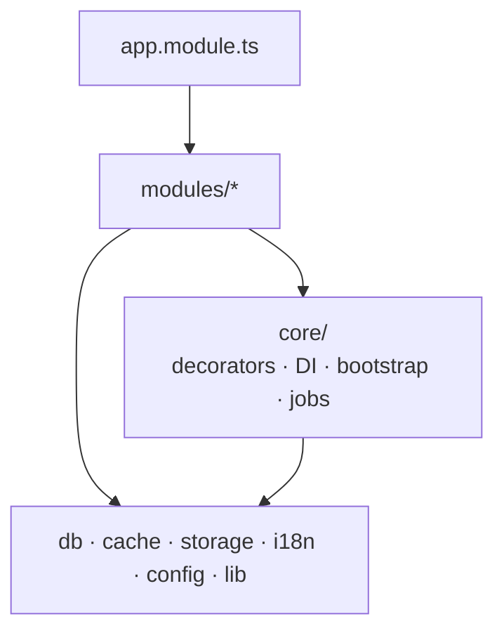
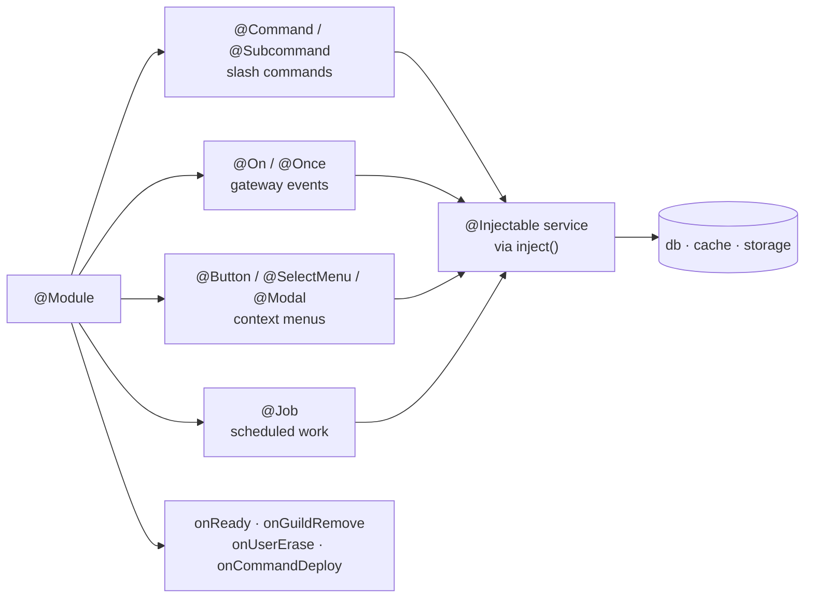
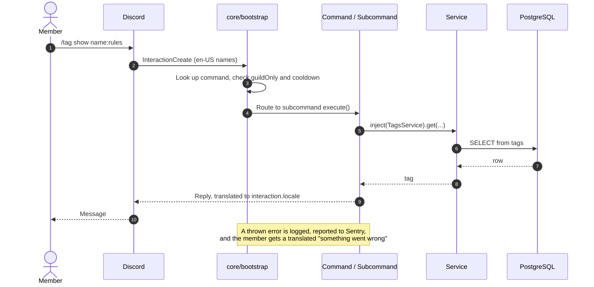
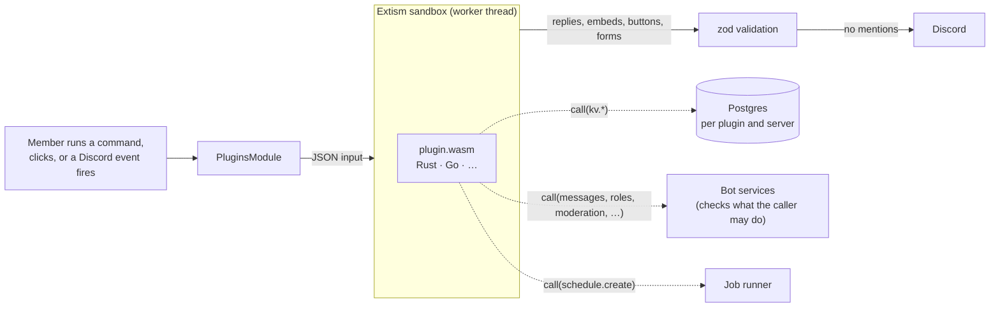
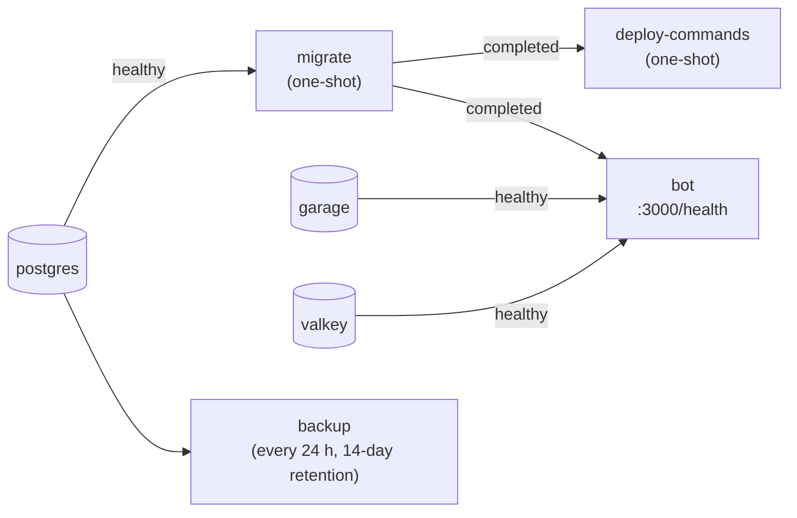

# roboteco

A modular, self-hosted Discord bot for communities, covering moderation, engagement, utilities and sandboxed community plugins.

[](https://www.typescriptlang.org)
[](https://discord.js.org)
[](https://nodejs.org)
[](LICENSE)

---

## Table of contents

- [Overview](#overview)
- [Features](#features)
- [Architecture](#architecture)
  - [System overview](#system-overview)
  - [Module map](#module-map)
  - [Request lifecycle](#request-lifecycle)
  - [Plugin sandbox](#plugin-sandbox)
- [Tech stack](#tech-stack)
- [Getting started](#getting-started)
- [Scripts](#scripts)
- [Deployment](#deployment)
- [Project structure](#project-structure)
- [Contributing](#contributing)
- [Documentation](#documentation)
- [License](#license)

---

## Overview

roboteco is one bot that does the jobs a community would otherwise split across several third-party bots: moderation, anti-spam, levels, giveaways, tickets, feeds, logs and more. You host it yourself. Each feature is its own module, and server staff configure it with slash commands.

Under the hood it uses a small **Angular-style framework built on decorators** (`@Module`, `@Command`, `@On`, `@Job`, `@Injectable`). Adding a feature means adding one folder and one import line. Community members can also add commands as **WebAssembly plugins**, which run in a sandbox and can't take the bot down.

**Highlights**

- **30 feature modules**, each self-contained under `src/modules/<feature>/`.
- **Fully localized** in `en-US` and `pt-BR`, including the names of slash commands and options.
- **Durable scheduling**: reminders, giveaways, temp bans and recurring posts are stored as jobs in Postgres, so they survive restarts.
- **Privacy built in**: `/privacy` lets members erase their data, and a server's data is purged after the bot leaves it.
- **Sandboxed plugins** written in Rust, Go or any other language that compiles to WASM, with CPU, memory and network limits.
- **Production-ready**: Docker Compose stack, health endpoint, Sentry reporting, automated database backups.

---

## Features

| Area | Modules | What they do |
| --- | --- | --- |
| **Moderation & safety** | `moderation`, `honeypot`, `automod`, `antiraid`, `verification`, `reports`, `logs` | Ban/kick/timeout/warn with numbered cases and a mod log, a spam-bot trap channel, Discord AutoMod rules, join-flood lockdowns, account-age verification, user/message reports, and a full server audit log |
| **Engagement** | `levels`, `starboard`, `drops`, `giveaways`, `counting`, `suggestions`, `birthdays`, `invites` | XP and role rewards, ⭐ starboard, reaction airdrops, giveaways, a counting game, suggestion voting, birthday announcements and invite tracking |
| **Utilities** | `tags`, `custom-commands`, `reminders`, `scheduled-posts`, `feeds`, `embeds`, `roles`, `tickets`, `welcome`, `temp-voice` | Saved snippets, server-specific slash commands, reminders, recurring announcements, RSS/Atom/YouTube feeds, fixed link previews, self-role pickers, private ticket threads, welcome messages and on-demand voice channels |
| **Platform** | `guilds`, `privacy`, `plugins`, `ping`, `dev` | Server lifecycle and data purging, `/privacy` data erasure, the WASM plugin host, a health check command, and event simulation (development only) |

See [docs/examples/community-features.md](docs/examples/community-features.md) for every command and setting.

---

## Architecture

### System overview

The bot is one Node.js process. It connects to Discord over the gateway and uses three backing services: PostgreSQL for data that must last, Valkey for fast expiring state, and Garage (S3-compatible) for files.



### Module map

`AppModule` imports every feature module. Modules talk to each other only through injected services. The dotted arrows below are the cross-module dependencies that exist in the code.



Inside the codebase, dependencies point one way. Feature modules use the framework and the shared infrastructure, and never the other way round. `pnpm lint` enforces this ([structure rules](docs/concepts/structure-rules.md)).



Each module is built from the same pieces:



### Request lifecycle

What happens when a member runs a slash command:



Time-based work goes through the same database. A command calls `schedule(Job, runAt, payload)`. The job runner claims due rows with `FOR UPDATE SKIP LOCKED` and retries failures with exponential backoff, so a restart or crash never loses a reminder or a giveaway ([jobs](docs/concepts/jobs.md)).

### Plugin sandbox

Plugins are WebAssembly modules that add commands, context menus, buttons and forms, and react to Discord events and scheduled runs. They take JSON in and return JSON out. They never see the token, the database, the disk or the network. Everything else goes through one host function, `call`, to capabilities: service methods marked `@Expose`, each behind a permission granted in `plugins/registry.json` (empty in releases).



Limits: 2 s per call, 64 MB of memory, no filesystem, and calls to each plugin are queued one at a time. A plugin can't do for a member what the member couldn't do themselves. See [plugins](docs/concepts/plugins.md).

---

## Tech stack

| Layer | Technology |
| --- | --- |
| Language / runtime | TypeScript, Node.js ≥ 22.12 |
| Discord | [discord.js](https://discord.js.org) v14 |
| Database | PostgreSQL 18 + [Drizzle ORM](https://orm.drizzle.team) |
| Cache | [Valkey](https://valkey.io) (via `iovalkey`) |
| Object storage | [Garage](https://garagehq.deuxfleurs.fr) (S3-compatible) |
| Plugins | [Extism](https://extism.org) (WebAssembly) |
| Validation | [zod](https://zod.dev) |
| Logging / errors | [pino](https://getpino.io), [Sentry](https://sentry.io) |
| Tooling | pnpm, esbuild, Biome, tsx, mise |

---

## Getting started

### Prerequisites

- [mise](https://mise.jdx.dev), which installs the pinned Node.js and pnpm (or Node.js ≥ 22.12 and pnpm yourself)
- Docker with Compose, to run Postgres, Valkey and Garage
- A Discord application and bot token from the [Developer Portal](https://discord.com/developers/applications)

### Quick start

```sh
mise install
cp .env.example .env   # fill in DISCORD_TOKEN and DISCORD_CLIENT_ID
pnpm install
pnpm services:up && pnpm storage:init && pnpm db:migrate
pnpm deploy-commands
pnpm dev
```

> [!TIP]
> Set `DISCORD_GUILD_ID` to a test server. `pnpm deploy-commands` then registers commands there instantly instead of globally.

> [!NOTE]
> `welcome`, `logs`, `antiraid`, `invites`, `counting` and `embeds` need the **Server Members** and **Message Content** privileged intents. Turn them on under *Bot → Privileged Gateway Intents*, then set `DISCORD_PRIVILEGED_INTENTS=true`.

See [docs/getting-started.md](docs/getting-started.md) for the full Discord app setup and every environment variable.

---

## Scripts

| Command | Description |
| --- | --- |
| `pnpm dev` | Run the bot with hot reload |
| `pnpm build` / `pnpm start` | Bundle with esbuild / run the bundle |
| `pnpm deploy-commands` | Register slash commands (built-in and plugin) with Discord |
| `pnpm typecheck` | Type-check with `tsc` |
| `pnpm lint` | Biome plus the project structure linter |
| `pnpm format` | Auto-fix formatting and lint issues |
| `pnpm services:up` / `services:down` | Start / stop the local Postgres, Valkey and Garage |
| `pnpm storage:init` | Create the Garage bucket and keys |
| `pnpm db:generate` / `db:migrate` | Generate / apply Drizzle migrations |
| `pnpm db:studio` | Open Drizzle Studio |
| `pnpm plugins:build` | Build the example plugin and the test fixture (Rust) |
| `pnpm prod:up` / `prod:logs` | Start the production stack / follow the bot logs |

---

## Deployment

The production stack is in `compose.prod.yaml`. Each release runs migrations first, then registers commands, then starts the bot:



```sh
pnpm prod:up
pnpm prod:logs
```

Migrations must stay compatible with the previous release, so a rollback never breaks the database. See [docs/operations/production.md](docs/operations/production.md) for releases, Sentry, health checks, backups and restores.

### CI/CD

[`ci.yml`](.github/workflows/ci.yml) runs `typecheck`, `lint`, a migration on a
fresh Postgres and `panel:check` on every pull request and on `main`.

The image is built by `giomartinsdev/gio-random-projects`, which owns the
self-hosted arm64 runner, the registry credential and the manifests. Its
`roboteco-image.yml` polls this repository's `main` every 15 minutes, builds
when the commit changes, and commits the new digest. Nothing here needs a
secret: the deploy side never trusts code from a public repository.

---

## Project structure

```
src/
  index.ts              bootstrap(AppModule)
  app.module.ts         root module: imports every feature module
  deploy-commands.ts    uploads commands (built-in and plugin) to Discord
  config.ts             validated environment
  logger.ts             pino logger, reportError (Sentry)
  core/                 decorators, DI, router, job scheduler, health
  modules/<feature>/    one folder per feature (commands, events, components, jobs, i18n, service)
  db/                   Drizzle client, schema, guild settings, migrations runner
  cache/                Valkey client
  storage/              S3 client
  i18n/                 translation helpers and combined locales
  lib/                  durations, safe URL fetching, WASM inspection
drizzle/                SQL migrations
plugins/                WASM plugin SDKs, the hello-rust example, the test fixture, registry.json
scripts/                build, structure lint, storage init, backups
docs/                   concept guides and worked examples
```

---

## Contributing

1. Read [docs/README.md](docs/README.md) and find your task in [*How do I…*](docs/README.md#how-do-i).
2. Put new behaviour in a feature module under `src/modules/<feature>/` and register it in `src/app.module.ts`.
3. Add every user-facing string to **both** `en-US` and `pt-BR`.
4. Change the database only through `src/db/schema.ts` + `pnpm db:generate`, and commit the generated migration.
5. Before opening a pull request, run:

   ```sh
   pnpm typecheck && pnpm lint && pnpm build
   ```

AI coding agents should start at [AGENTS.md](AGENTS.md), which lists the project rules.

---

## Documentation

| Guide | Description |
| --- | --- |
| [Getting started](docs/getting-started.md) | Requirements, Discord setup, environment variables |
| [Architecture](docs/architecture.md) | How the pieces fit together |
| [Concepts](docs/README.md#concepts) | Modules, commands, events, services, i18n, database, cache, storage, jobs, plugins |
| [Community features](docs/examples/community-features.md) | Every feature module and its commands |
| [Moderation](docs/examples/moderation.md) | Shared checks, numbered cases, mod log |
| [Honeypot](docs/examples/honeypot.md) | A complete feature using every concept |
| [Privacy](docs/examples/privacy.md) | Data erasure and retention |
| [Production](docs/operations/production.md) | Docker, releases, monitoring, backups |

---

## License

Released under the [GNU General Public License v3.0](LICENSE).
