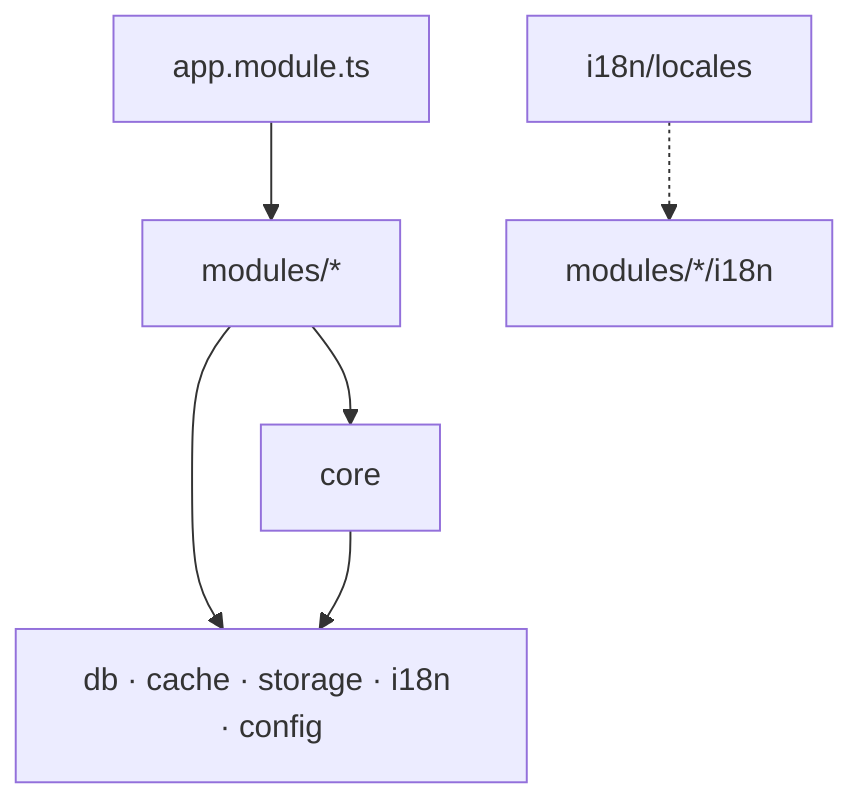

# Architecture

## What it is

roboteco is built as feature modules on a small framework, in the style of Angular:
- **Feature modules** (`src/modules/`) contain all the bot's behaviour.
- **The framework** (`src/core/`) provides the decorators and the bootstrap.
- **Shared infrastructure** (`db`, `storage`, `i18n`, `config`) is used by both.

```
src/
  index.ts              bootstrap(AppModule)
  app.module.ts         root module: imports every feature module
  deploy-commands.ts    uploads AppModule's commands (and plugin commands) to Discord
  config.ts             validated environment
  logger.ts             pino logger, reportError (Sentry)
  core/                 @Module, @Command/@Subcommand, context menus, @Button/@SelectMenu/@Modal,
                        @On/@Once, @Job + scheduler, @Injectable/inject, bootstrap, health
  modules/<feature>/    one folder per feature
  db/                   Drizzle client, schema, guild settings helpers, migrate.ts
  cache/                Valkey client
  storage/              S3 client
  lib/                  shared helpers: durations, safe URL fetching, WASM inspection
  i18n/                 translation helpers; locales/ combines module translations
drizzle/                SQL migrations
plugins/                WASM plugin SDKs and examples, registry.json (empty), registry.example.json, dist/ (built)
biome-plugins/          custom lint rules
scripts/                build.ts, build-plugins.sh, plugin.ts (plugin dev CLI), lint-structure.ts, storage-init.sh, backup.sh
tests/                  pnpm test: behaviour tests against the real Postgres and Valkey
```

## What it's for

- **Features stay independent.** Adding one is a new folder plus one line in `AppModule`, and deleting it is the reverse.
- **The framework does the plumbing.** Routing, error replies, intents and command registration are written once in `core`, so features contain only behaviour.
- **Dependencies point one way**, and the [structure rules](concepts/structure-rules.md) keep them like that:



## How it works

| Concept | One line | Read |
| --- | --- | --- |
| Module | Groups a feature's commands, events and intents | [modules](concepts/modules.md) |
| Command | One slash command and its handler | [commands](concepts/commands.md) |
| Subcommand | One action under a command (`/tag add`) | [subcommands](concepts/subcommands.md) |
| Event | Reacts to something happening in Discord | [events](concepts/events.md) |
| Component / context menu | Buttons, menus, forms; right-click actions | [components](concepts/components.md), [context menus](concepts/context-menus.md) |
| Job | Work that runs later and survives restarts | [jobs](concepts/jobs.md) |
| Service | Shared state and data access, via `inject` | [services](concepts/services.md) |
| Translation | Every text, in every language | [i18n](concepts/i18n.md) |
| Database / storage | Where data and files persist | [database](concepts/database.md), [storage](concepts/storage.md) |

At runtime:

1. `bootstrap(AppModule)` walks `imports`, collects every module's intents, commands and events, and creates one instance of each.
2. It logs in with the combined intents and subscribes each event class. A failing handler is logged and doesn't stop the bot.
3. After login, it calls every module's `onReady` and starts the job runner.
4. Interactions are routed by type. Autocomplete goes to the command's `autocomplete`, context menus are found by type and name, and components by the first part of their `customId`. Slash commands are looked up by name:
   - guild-only commands are rejected outside servers;
   - subcommands are routed to their class;
   - thrown errors become a translated "something went wrong" reply.

## Example: what happens on `/tag show name:rules`

Using the `tags` module from the concept docs:

1. **Registration.** `pnpm deploy-commands` uploaded `/tag` with its subcommands and both languages.
2. **Lookup.** A member types `/tag mostrar nome:rules` (pt-BR client). Discord sends `tag` / `show` / `name=rules`, always using the en-US names.
3. **Routing.**
   - The bootstrap's interaction listener finds `TagCommand`.
   - `guildOnly` passes because the member is in a server.
   - The `show` subcommand goes to `ShowSubcommand.execute`.
4. **Data.** `ShowSubcommand` asks its injected `TagsService`, which queries the `tags` table.
5. **Reply.**
   - If the tag exists, the reply is its content, with mentions disabled.
   - Otherwise the reply is `tags.replies.notFound`, translated with `interaction.locale`: "Nenhuma tag chamada **rules**."
6. **Errors.** If anything throws, the user gets `errors.commandFailed` in Portuguese and the error is logged.

[The honeypot example](examples/honeypot.md) walks through the real feature in this repository the same way.
